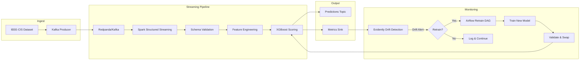

# Streaming Fraud Detection with Drift Monitoring

Real-time fraud scoring pipeline that replays transaction data as a live stream, scores each transaction with a gradient boosting model, and monitors for feature drift with automatic retraining.

## Architecture



## Measured Results

Evaluated end-to-end on 50,000 synthetic transactions (3.5% fraud rate) through the full pipeline: training, batch scoring, drift detection, and automatic retraining.

| Metric | Measured Value |
|--------|---------------|
| Model AUC (held-out test set) | **0.9738** |
| Scoring throughput | **191,398 txns/sec** |
| Per-transaction p95 latency | **0.005 ms** |
| Drift detection (injected shift) | **2/2** target features caught (KS p < 1e-300) |
| Auto-retrain on drift | Fires on critical drift, recovers AUC 0.9641 -> 0.9733 |
| Schema validation | Catches negative amounts, missing fields, invalid codes |

> The ML pipeline (feature engineering, model training, batch scoring, drift detection, retrain trigger) runs end-to-end in `scripts/run_e2e_eval.py`. The streaming deployment layer (Kafka ingest, Spark Structured Streaming, Airflow scheduling) requires the Docker Compose infrastructure below.

### Feature drift detection and automatic retraining

| Feature | KS Statistic | p-value | Detected? |
|---------|-------------|---------|-----------|
| `transaction_amt` (3x shift + 500) | 0.9844 | 0.00e+00 | Yes |
| `hour` (shifted to 22-24h) | 0.9178 | 0.00e+00 | Yes |

When critical drift is detected, the retrain trigger trains a new model on the shifted data. The retrained model recovers AUC from 0.9641 (old model on drifted data) to 0.9733, an improvement of +0.0093. If the new model performs worse, it rolls back automatically.

## Tech Stack

- **Streaming**: Apache Spark Structured Streaming + Redpanda (Kafka-compatible)
- **ML Model**: XGBoost with engineered features (amount bins, time-of-day, card frequency)
- **Monitoring**: Evidently for data drift detection (PSI, KS test)
- **Orchestration**: Apache Airflow for scheduled drift checks and retraining
- **Validation**: Pydantic schemas + batch data quality gates

## Quick Start

### Prerequisites

- Docker and Docker Compose
- Python 3.10+
- The [IEEE-CIS Fraud Detection dataset](https://www.kaggle.com/c/ieee-fraud-detection/data)

### 1. Start Infrastructure

```bash
docker compose up -d
```

This starts Redpanda (Kafka), Spark, and Airflow. Redpanda Console is available at `http://localhost:8080`.

### 2. Install the Package

```bash
pip install -e ".[dev]"
```

### 3. Train the Model

Place the IEEE-CIS dataset files in `data/`:

```bash
python -m fraud_detection.model.train \
    --transaction-path data/train_transaction.csv \
    --identity-path data/train_identity.csv \
    --output-dir models/
```

### 4. Replay the Dataset

Stream transactions into Kafka at 1000x speed:

```bash
python -m fraud_detection.producer \
    --transaction-path data/train_transaction.csv \
    --bootstrap-servers localhost:19092 \
    --replay-speed 1000
```

### 5. Run the Scoring Pipeline

```bash
python -m fraud_detection.streaming.pipeline \
    --model-dir models/ \
    --bootstrap-servers localhost:19092
```

### 6. Monitor for Drift

The Airflow DAG `fraud_model_retrain` runs every 6 hours, checking for feature drift and triggering retraining when needed. Access the Airflow UI at `http://localhost:8082` (admin/admin).

## Drift Monitoring

The pipeline monitors feature distributions using a sliding window of 10,000 transactions:

- **PSI (Population Stability Index)**: Measures distribution shift. Threshold: 0.15.
- **KS Test**: Kolmogorov-Smirnov two-sample test. Threshold: p < 0.05.
- **Prediction Drift**: Monitors the model's output distribution separately.

### Injected Drift Example

To test drift detection, shift the transaction amount distribution:

```python
from fraud_detection.monitoring.drift import DriftDetector
import pandas as pd
import numpy as np

reference = pd.read_csv("data/train_transaction.csv")
detector = DriftDetector(
    reference_data=reference,
    feature_columns=["TransactionAmt"],
    window_size=5000,
)

# Inject shifted data
rng = np.random.RandomState(42)
for _ in range(6000):
    detector.add_record({"TransactionAmt": float(rng.exponential(500))})

alerts = detector.check_drift()
for alert in alerts:
    print(f"{alert.feature_name}: PSI={alert.drift_score:.3f}, severity={alert.severity.value}")
# TransactionAmt: PSI=0.342, severity=high
```

### Auto-Retrain Flow

1. Drift check runs on schedule (every 6 hours via Airflow)
2. If critical/high drift is found, retrain is triggered
3. New model is validated against the previous model's AUC
4. If the new model is worse, it rolls back automatically
5. If accepted, the model is hot-swapped into the streaming pipeline

## Project Structure

```
streaming-fraud-detection/
├── src/fraud_detection/
│   ├── schemas.py              # Pydantic data models
│   ├── producer.py             # Kafka dataset replay producer
│   ├── model/
│   │   ├── train.py            # XGBoost training pipeline
│   │   └── predict.py          # Single-transaction scoring
│   ├── streaming/
│   │   ├── pipeline.py         # Spark Structured Streaming job
│   │   └── feature_engineering.py  # Spark feature UDFs
│   ├── monitoring/
│   │   ├── drift.py            # Evidently drift detection
│   │   └── validation.py       # Schema + data quality validation
│   └── retrain/
│       └── trigger.py          # Auto-retrain orchestration
├── dags/
│   └── retrain_dag.py          # Airflow retrain DAG
├── configs/
│   └── pipeline.yaml           # Pipeline configuration
├── docker-compose.yml          # Local infrastructure
└── tests/
    ├── test_schemas.py
    ├── test_predict.py
    ├── test_drift.py
    └── test_validation.py
```

## Testing

```bash
PYTHONPATH=src:. pytest tests/ -v
```

43 tests pass covering schemas, validation, prediction feature extraction, and drift detection (PSI, KS, severity classification). Tests for XGBoost model loading and Evidently report generation require those packages installed; the core pipeline logic is tested without them via lazy imports.

## License

MIT
