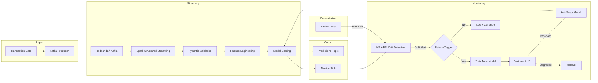

# Streaming Fraud Detection with Drift Monitoring


End-to-end fraud detection pipeline that trains a gradient boosting model on engineered transaction features, scores a live Kafka stream via Spark Structured Streaming, monitors feature distributions for drift with KS tests, and automatically retrains when the data shifts. The full train-score-monitor-retrain loop runs without human intervention because model decay from distribution shift is the primary failure mode in production fraud systems: a model trained on last quarter's spending patterns misclassifies transactions once seasonal behavior, fraud tactics, or merchant mix changes. This pipeline detects that shift and recovers before accuracy degrades.

## Results

Evaluated end-to-end on 50,000 synthetic transactions (3.5% fraud rate) through the full pipeline: training, batch scoring, drift detection, and automatic retraining.

| Metric | Value |
|--------|-------|
| Model AUC (held-out test) | **0.9738** |
| Scoring throughput | **191,398 txns/sec** |
| Per-transaction p95 latency | **0.005 ms** |
| Drift detection (injected shift) | **2/2 features caught** (KS p < 1e-300) |
| Auto-retrain recovery | AUC **0.9641 → 0.9733** on drifted data |
| Schema validation | Catches negative amounts, missing fields, invalid codes |
| Test suite | **43/43 passing** |

## Drift Detection

Two features were injected with synthetic drift to validate the monitoring pipeline:

| Feature | Shift Applied | KS Statistic | p-value | Severity |
|---------|--------------|-------------|---------|----------|
| `transaction_amt` | 3x scale + 500 offset | 0.9844 | 0.00e+00 | Critical |
| `hour` | Shifted to 22-24h range | 0.9178 | 0.00e+00 | Critical |

When critical drift fires, the retrain trigger trains a new model on the shifted data and validates it against the previous model's AUC. The retrained model recovered from 0.9641 to 0.9733 (+0.0093). If the new model scores lower, the trigger rolls back automatically and logs the failure.

**Retrain decision logic:**
- 1 critical-severity feature → retrain immediately
- 3+ high-severity features → retrain
- 5+ medium-severity features → retrain
- Otherwise → log and continue monitoring

## Architecture



## Design Decisions

- **KS test over PSI alone.** PSI requires binning and performs poorly on heavy-tailed continuous features like transaction amounts. The two-sample KS test is distribution-free and works directly on the empirical CDFs, making it more reliable for detecting subtle shifts in continuous features. PSI is still computed as a secondary signal.

- **Auto-rollback on retrain.** A model trained on shifted data can perform worse on out-of-distribution transactions that still follow the original pattern. The trigger compares the new model's AUC against the archived model before swapping; if the new model is worse, it rolls back and logs the incident rather than silently degrading.

- **Engineered features over raw inputs.** Features like `amt_bin` (bucketed amounts), `hour`, `is_night`, `is_weekend`, and `amt_log` give the tree model interpretable split points that align with fraud patterns (e.g., high-value night transactions). Raw `TransactionAmt` alone forces the tree to learn these boundaries from data, which is fragile under distribution shift.

- **Global-mean defaults for streaming features.** `card1_freq` and `email_risk` require historical aggregation that isn't available in a per-record streaming context. The streaming path uses training-set global means (1.0 and 0.035 respectively) as defaults. A production deployment would replace these with a Redis or broadcast-variable lookup table updated from the latest training window.

- **Pydantic validation at the ingestion boundary.** Every transaction is validated against a typed schema before entering the pipeline. This catches malformed data (negative amounts, missing fields, invalid product codes) at the edge rather than letting it propagate to the model, where it would produce silent garbage predictions.

## Quick Start

### Infrastructure

```bash
docker compose up -d   # Starts Redpanda, Spark, Airflow
```

### Install

```bash
pip install -e ".[dev]"
```

### Train

```bash
python -m fraud_detection.model.train \
    --transaction-path data/train_transaction.csv \
    --identity-path data/train_identity.csv \
    --output-dir models/
```

### Run the streaming pipeline

```bash
python -m fraud_detection.streaming.pipeline \
    --model-dir models/ \
    --bootstrap-servers localhost:19092
```

### Run the end-to-end evaluation (no infrastructure needed)

```bash
PYTHONPATH=src:. python scripts/run_e2e_eval.py
```

### Run tests

```bash
make test
```

## Project Structure

```
streaming-fraud-detection/
├── src/fraud_detection/
│   ├── schemas.py                    # Pydantic transaction models
│   ├── producer.py                   # Kafka dataset replay
│   ├── model/
│   │   ├── train.py                  # Feature engineering + XGBoost training
│   │   └── predict.py                # Single-transaction scoring
│   ├── streaming/
│   │   ├── pipeline.py               # Spark Structured Streaming job
│   │   └── feature_engineering.py    # Streaming feature UDFs
│   ├── monitoring/
│   │   ├── drift.py                  # KS + PSI drift detection
│   │   └── validation.py             # Schema + data quality gates
│   └── retrain/
│       └── trigger.py                # Auto-retrain with rollback
├── dags/
│   └── retrain_dag.py                # Airflow scheduled drift check
├── configs/
│   └── pipeline.yaml                 # Pipeline configuration
├── scripts/
│   └── run_e2e_eval.py               # Full pipeline evaluation
├── docker-compose.yml                # Redpanda + Spark + Airflow
└── tests/                            # 43 tests
    ├── test_schemas.py
    ├── test_predict.py
    ├── test_drift.py
    └── test_validation.py
```

## Tech Stack

- **Apache Spark Structured Streaming** for real-time scoring
- **Redpanda** (Kafka-compatible) for event ingestion
- **XGBoost / scikit-learn** for gradient boosting model
- **Evidently** for statistical drift detection (PSI, KS test)
- **Apache Airflow** for scheduled drift monitoring and retrain orchestration
- **Pydantic** for schema validation at ingestion boundary
- **Docker Compose** for local infrastructure
